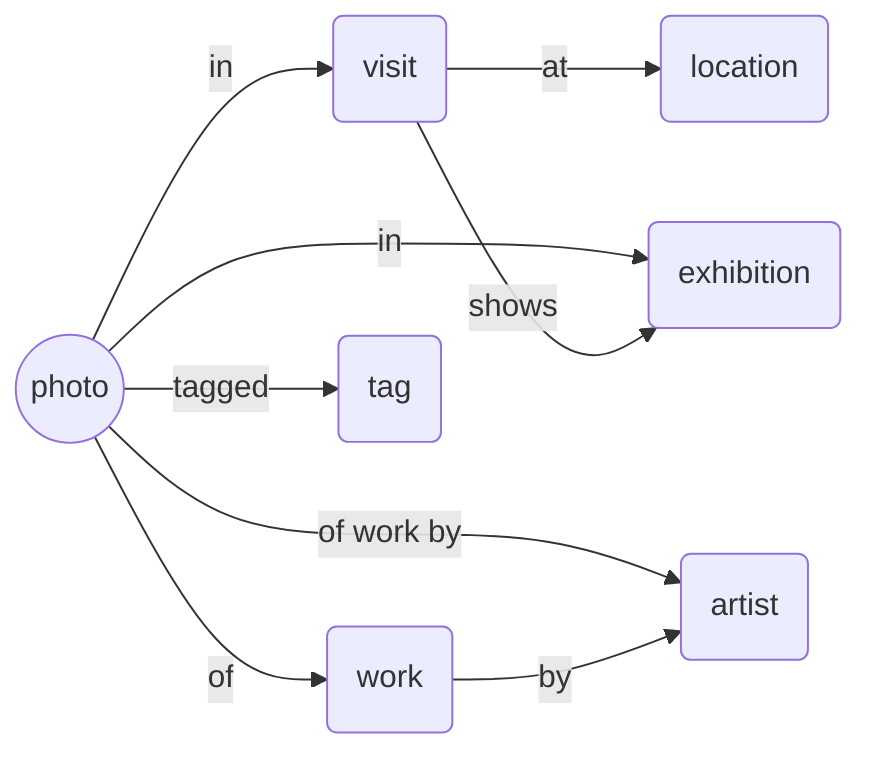

# Photos

A photo archive. Every photo is its own page, linked to the artist, work,
location, visit, exhibition and tags it belongs to. The site is static — built
into plain files at deploy time, no database, no client-side data fetching.

Hosted at https://lab.cartoonbeats.com/photos/.

## Import photos

An import is one visit: one place on one day.

### 1. Export from Apple Photos

Input: the Apple Photos library.

Output: one folder per moment — e.g. `Auckland, 29 June 2025/` — of
maximum-quality JPEGs with captions and keywords embedded.

- File → Export → Export Photos…
- Photo kind: JPEG
- Quality: Maximum
- Include: Caption, Keywords

### 2. Move each moment into `incoming/`

Input: the moment folders from step 1.

Output: `incoming/<Location, date>/`, one folder per visit. The folder name is a
label only.

- Copy the exported moment folders into `incoming/`.
- One folder = one visit. Several shows at one gallery stay in the same folder.

### 3. Sort a mixed-date folder

Only when the export is one folder spanning several days, not moments.

Input: a flat folder of photos.

Output: `incoming/<yyyymmdd>/` folders, each with a draft `photos.yml`.

```sh
npm run sort:photos -- ~/Desktop/raw-export
```

- Reads each photo's capture date.
- Copies it into a dated folder and writes a blank `photos.yml`.
- Skip this step when Apple already grouped the export by moment.

### 4. Convert videos

Only when the export contains `.mov` files.

Input: `.mov` from a phone (or any video).

Output: `.mp4` beside the source, a silent web loop, ready to import.

#### Usage

```sh
npm run convert:videos -- ~/Desktop/raw-export/IMG_4821.mov --mode loop --max-duration 8
npm run convert:videos -- ~/Desktop/raw-export
```

- Single file: converts that one file (the example adds `--mode loop` and an
  8-second trim).
- Folder: walks the folder and every subfolder, converting each video in place.

#### Behaviour

- Default is a boomerang (forward + reversed, seamless loop).
- `--mode loop` for a straight clip.
- Already-converted files are skipped unless `--force`.

#### Dependencies

- `ffmpeg` and `ffprobe` on the PATH. macOS: `brew install ffmpeg`.

### 5. Import

Input: `incoming/` (or another top folder) of visit folders.

Output: images and metadata in `src/content/photos/<year>/<yyyymmdd>/`, plus
artist, location, exhibition and visit records as needed.

```sh
npm run import:photos
```

- Prompts once per folder for location and exhibitions.
- Writes those answers to the folder's `photos.yml`.
- `--preview` prints the plan without writing; `--apply` skips all prompts.

### 6. Review and re-run

Input: the import's `git diff`.

Output: corrected `photos.yml` and content.

```sh
npm run import:photos
```

- Edit the folder's `photos.yml`, then import again.
- Already-imported photos are recognised by content, so only changed answers
  are applied.

### Edit the manifest (`photos.yml`)

One per folder, written by the importer and hand-editable.

```yaml
location: Auckland Art Gallery
date: 2025-06-29
exhibitions:
  - Fiona Pardington
  - name: Ancient Worlds
    tags: [archaeology]
tags: [gallery]
photos:
  IMG_7302.jpeg:
    exhibition: Fiona Pardington
    artists: [Fiona Pardington]
    tags: [photography]
```

- `location` and `exhibitions` take a name or an id; a close-match typo is
  corrected, an unmatched name becomes a new record.
- `tags` and each exhibition's `tags` are added to the photos of that
  visit/show. Tags live only on photos, never on records.
- Dates come from the photos themselves; `date` overrides the whole folder.

## Structure

### Routes and site map

| Route | Page |
|---|---|
| `/` | all photos, grouped by visit (or date), newest first |
| `/photos/{yyyymmdd}/{slug}/` | one photo or video with its metadata card |
| `/artists/` | artist index |
| `/locations/` | location index |
| `/tags/` | tag cloud |
| `/artists/{id}/` | one artist's photos |
| `/works/{id}/` | photos of one work |
| `/locations/{id}/` | photos from one location, grouped by visit |
| `/visits/{id}/` | photos from one visit |
| `/exhibitions/{id}/` | photos from one exhibition |
| `/tags/{tag}/` | photos with one tag |

### Content model

```text
src/content/
  photos/<year>/<yyyymmdd>/<yyyymmdd>-<stem>.jpg   # the image
  photos/<year>/<yyyymmdd>/<yyyymmdd>-<stem>.md    # its metadata
  artists/<id>.md
  locations/<id>.md
  exhibitions/<id>.md
  works/<id>.md
  visits/<year>/<yyyymmdd>-<location>.md
  tag-metadata/tags.yml
```




- Tags belong only to photos; visit and exhibition tags are added to the photos at import.
- Some common tags are hidden in UI, e.g. `art`, `desktop`, `wallpaper`, `mobile`.

## Develop

```sh
npm install
npm run dev
npm run build
```

Deploys to GitHub Pages automatically on every push to `main` (GitHub Actions;
enable Pages → Source: GitHub Actions once per repo).

Licensing: photos [CC BY 4.0](LICENSE), site code [MIT](LICENSE-CODE).
