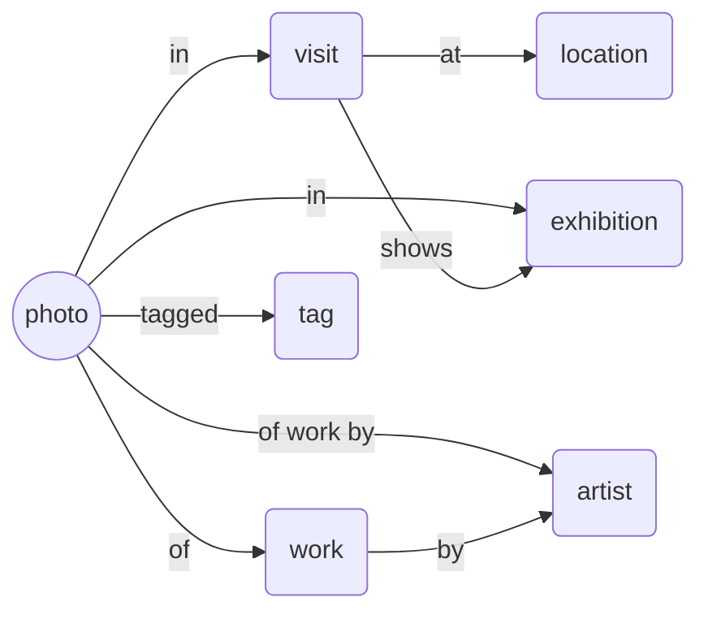

# Photos

A photo archive. Every photo is its own page, linked to the artist, work,
location, visit, exhibition and tags it belongs to. The site is static — built
into plain files at deploy time, no database, no client-side data fetching.

Hosted at https://lab.cartoonbeats.com/photos/.

## Import photos

An import is one visit: one place on one day.

- Start: folder of image files, grouped by visit
- (optional) Use script to split folders by date automatically
- (optional) Convert videos to looping web format
  - Defaults
  - Dependencies
- Generate metadata for import
- (optional) Edit metadata for import (`photos.yml`)
- Import
- Review and re-run

### Start: folder of image files, grouped by visit

For example, export from Apple Photos:

- `File → Export → Export [n] Photos…`
- `Photo Kind: JPEG`
- `Include:` 
  - [x] `Title, Keywords and Caption`
  - [x] `Location Information`
- `Subfolder format: Moment Name`

Output: folder with subfolders for each visit, containing high-quality images.

Optionally, organise the photos into subfolders for each visit (e.g. different locations on same day), or even different exhibits at same location.

For example:

- `incoming`
  - `Auckland, 29 June 2025 - Auckland Art Gallery`
  - `Auckland, 29 June 2025 - Michael Lett`

### (optional) Sort into date folders

Only when the export is one flat folder spanning several days, not moments.

Input: a flat folder of photos.

Output: `incoming/<yyyymmdd>/` folders.

```sh
npm run sort-by-date -- ~/Desktop/raw-export
```

- Reads each photo's capture date and copies it into a dated folder.
- Knows nothing about the data model — the import step creates `photos.yml`.
- Skip this step when Apple already grouped the export by moment.

### (optional) Convert videos to looping web format

Only when the export contains `.mov` files.

Input: `.mov` from a phone (or any video).

Output: `.mp4` beside the source, a silent web loop, ready to import.

```sh
npm run convert:videos -- ~/Desktop/raw-export              # every video, incl. subfolders
npm run convert:videos -- ~/Desktop/raw-export/IMG_4821.mov --mode loop --max-duration 8
```

#### Defaults

- Mode: boomerang (forward + reversed, seamless loop); `--mode loop` for a straight clip.
- Trim: none — the whole clip; `--max-duration` cuts it to n seconds.
- Resolution and frame rate: unchanged; `--max-width` only downscales if wider (default 3840px), `--fps` resamples.
- Quality: CRF 18; `--crf` changes it.
- Existing `.mp4` files are skipped; `--force` re-encodes them.

#### Dependencies

- `ffmpeg` and `ffprobe` on the PATH. macOS: `brew install ffmpeg`.

### Generate metadata for import

First run asks for each folder's location and exhibitions, then writes that
folder's `photos.yml` — a self-documenting template showing every editable
field. Stop before it imports if you want to edit first — answer `n` at the
confirm, or use `--preview` to see the plan without writing.

Input: a folder of visit folders.

Output: a `photos.yml` in each folder.

```sh
npm run import:photos ./incoming
```

- `incoming/` is only a convention — pass any top folder.
- Prompts once per folder for location and exhibitions.
- Writes the answers to each folder's `photos.yml`.
- `--preview` prints the plan without writing anything.

### (optional) Edit metadata for import (`photos.yml`)

One per folder, written by the importer and hand-editable.

```yaml
location: Auckland Art Gallery
# Or with record fields:
# location:
#   name: Auckland Art Gallery
#   url: https://aucklandartgallery.com
date: 2025-06-29
exhibitions:
  - Fiona Pardington
  - name: Ancient Worlds
    tags: [archaeology]
    url: https://example.com/ancient-worlds
tags: [gallery]
photos:
  IMG_7302.jpeg:
    exhibition: Fiona Pardington
    artists: [Fiona Pardington]
    tags: [photography]
```

- `location` and each exhibition are a name, or an object whose extra keys
  mirror the record's frontmatter — `links`, `url`, dates, address and so on.
  `url` is shorthand for `links: [{ url }]`; those fields land on the record
  when it is created.
- `tags` and each exhibition's `tags` are added to the photos of that
  visit/show. Tags live only on photos, never on records.
- A close-match typo is corrected, an unmatched name becomes a new record.
- Dates come from the photos themselves; `date` overrides the whole folder.

### Import

Applies every manifest: copies images, writes photo metadata, and creates any
missing artist, location, exhibition and visit records.

Input: a folder of visit folders, each with a `photos.yml`.

Output: images and metadata in `src/content/photos/<year>/<yyyymmdd>/`, plus
records as needed.

```sh
npm run import:photos ./incoming
```

- `--apply` skips prompts and imports straight from the manifests.
- Already-imported photos are recognised by content, so only changed answers
  are applied.

### Review and re-run

Input: the import's `git diff`.

Output: corrected `photos.yml` and content.

```sh
npm run import:photos ./incoming
```

- Edit a folder's `photos.yml`, then import again.


## Structure

### Routes and site map

| Route | Page |
|---|---|
| `/` | all photos, grouped by visit (or date), newest first |
| `/photos/{yyyymmdd}/{slug}/` | one photo or video with its metadata card |
| `/artists/` | artist index |
| `/locations/` | location index |
| `/tags/` | tag cloud |
| `/artists/{id}/` | one artist's photos |
| `/works/{id}/` | photos of one work |
| `/locations/{id}/` | photos from one location, grouped by visit |
| `/visits/{id}/` | photos from one visit |
| `/exhibitions/{id}/` | photos from one exhibition |
| `/tags/{tag}/` | photos with one tag |

### Content model

```text
src/content/
  photos/<year>/<yyyymmdd>/<yyyymmdd>-<stem>.jpg   # the image
  photos/<year>/<yyyymmdd>/<yyyymmdd>-<stem>.md    # its metadata
  artists/<id>.md
  locations/<id>.md
  exhibitions/<id>.md
  works/<id>.md
  visits/<year>/<yyyymmdd>-<location>.md
  tag-metadata/tags.yml
```




- Tags belong only to photos; visit and exhibition tags are added to the photos at import.
- Some common tags are hidden in UI, e.g. `art`, `desktop`, `wallpaper`, `mobile`.

## Develop

```sh
npm install
npm run dev
npm run build
```

Deploys to GitHub Pages automatically on every push to `main` (GitHub Actions;
enable Pages → Source: GitHub Actions once per repo).

Licensing: photos [CC BY 4.0](LICENSE), site code [MIT](LICENSE-CODE).
